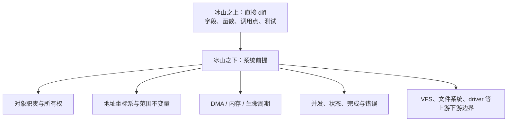
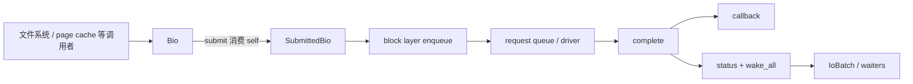

# 上游 PR 学习与重写规范

## 执行摘要

本规范用于将“看懂一个上游 PR”变成可重复执行、可验证、可沉淀的工程学习过程。

核心要求是：**先建立系统模型，再阅读局部代码；先确认 PR 的可信边界，再手写练习；直接 diff 是冰山之上，决定代码是否正确的对象关系、地址语义、资源生命周期和失败边界是冰山之下。**

本文件记录可跨 PR 复用的方法，并以 PR 1 `block: add mapped BIO ranges` 为首个实践案例。PR 1 的具体技术细节保存在 [PR1-mapped-ranges-bio_study.md](../log/study/PR1-mapped-ranges-bio_study.md)；本文件侧重“怎样学习、怎样重写、怎样验证”。

---

## 1. 目标、范围与边界

### 1.1 目标

每个学习 PR 应产出四类成果：

1. **变更边界**：确认该 PR 的 base、HEAD、正式文件、非目标和依赖；
2. **系统模型**：说明请求、数据、资源和错误跨层如何流动；
3. **可独立重写的理解**：能在隔离练习副本中手写核心改动，并解释每个改动的前置不变量；
4. **验证结论**：区分已运行的检查、已证实的事实、从源码推导的结论和仍待验证的边界。

### 1.2 不应做什么

- 不能只按 diff 逐行翻译 Rust，而跳过对象职责、所有权与调用链；
- 不能把主开发工作区当作学习草稿区；
- 不能把后续分支、历史备份或相邻 PR 的变化误认为当前 PR 正式范围；
- 不能把主链已验证扩大成“所有路径已验证”；
- 不能把计划、推断或未运行测试写成完成事实。

### 1.3 适用范围

本流程适用于具有下列任一特征的 PR：

- 修改核心数据结构、公开 API 或对象所有权；
- 涉及 block、VFS、filesystem、driver、并发、DMA、Device Mapper 等跨层语义；
- diff 很小但正确性依赖系统不变量；
- 后续需要独立重写、评审或拆分为上游最小 PR。

纯机械重命名、单点 typo 或无语义格式调整可简化流程，但仍应确认变更范围。

---

## 2. 核心学习原则

### 2.1 先模型，后表达式

阅读顺序应为：

```text
调用者和目标行为
→ 对象、职责、所有权、生命周期
→ 地址 / 内存 / 并发 / 错误边界
→ 文件级改动
→ Rust API 和局部表达式
→ 手写与验证
```

若一个表达式依赖 `BioSegment`、`Arc`、DMA、状态机或地址坐标系，不先说明这些前置概念，就不应急于解释语法。

### 2.2 冰山模型



直接改动必须按文件讲清；但学习记录必须同时记下它依赖的前提。只有冰山之上正确，不代表系统行为正确。

### 2.3 区分证据等级

所有结论必须标记为以下之一：

| 等级 | 含义 | 示例 |
|---|---|---|
| 当前源码事实 | 可在当前 base / HEAD 源码或最终 diff 中直接确认 | 某字段被替换、某调用点改为 `?` |
| 源码推导 | 由多个已知实现事实得出的结论 | 某 API 保持 range 长度 |
| 设计推导 | 从对象模型或目标语义推得的需求 | striped 跨边界需要拆分请求 |
| 待验证 | 尚未追踪到全部调用者、测试或实现 | 所有 BIO 构造路径都完成范围验证 |

严禁把后三类写成“当前已经实现”。

### 2.4 小步推进

- 一个大标题可包含多个相关改动；每次只解释一个小逻辑点；
- 每个小点必须给出精确文件/行号、最小必要上下文和统一 diff；
- 说明顺序为：**原来做什么 → 现在做什么 → 为什么 → 失败时如何表现**；
- 首次遇到结构性变更时，必须同时展示字段定义、初始化位置和公开 API，避免只看调用点导致编辑器标红、理解断裂；
- 进入提问环节时，每轮最多三个问题，按理解依赖排序。

---

## 3. 每个 PR 的标准学习流程

## 阶段 0：建立可信 PR 档案

先创建或更新该 PR 的技术档案，至少记录：

| 项目 | 要回答的问题 |
|---|---|
| 身份 | 标题、上游链接、base、HEAD、对应提交 |
| 正式范围 | 哪些文件进入 PR，哪些没有进入 |
| 目标 | 原行为、目标行为、最小输入输出示例 |
| 非目标 | 相邻能力、后续 PR、历史备份中但不属于本 PR 的变化 |
| 依赖 | 依赖哪些前置 PR，后续哪些 PR 依赖它 |
| 验证 | 最终提交实际运行了什么检查；当前学习阶段实际运行了什么 |

推荐证据优先级：

```text
最终 commit / 正式 patch
→ 当前基线和 HEAD 源码
→ 项目设计文档
→ 历史备份和后续分支
→ 外部网页或讨论
```

历史迁移 patch 若含额外文件或后续演进，只能用作线索，不能扩大正式范围。

## 阶段 1：准备隔离练习环境

当要亲手改源码时：

1. 从已确认 base 创建独立练习副本；
2. 主开发分支保持不作为学习草稿区；
3. 练习副本已有改动时，先阅读其 diff，绝不 reset、覆盖或假定其归属；
4. 明确区分：

```text
练习副本
= 用于理解和手写，不构成权威实现。

主开发分支
= 当前项目的权威工程实现和验证来源。

上游 PR 分支
= 从 main 提取最小、已验证生产 diff 的交付分支。
```

## 阶段 2：定义原行为、目标行为和最小例子

任何新阶段先用自然语言写清：

```text
原来行为：谁保存什么信息，谁在何时解释它。
目标行为：谁改为保存什么信息，谁从此负责解释它。
最小例子：输入、经过一层或多层处理后的输出。
不变部分：哪些资源、完成语义、接口边界不改变。
```

没有最小例子时，地址转换、资源转移和错误路径常会被误解成“只是字段改名”。

## 阶段 3：构建冰山下模型

按任务需要追踪下列问题：

| 主题 | 核心问题 |
|---|---|
| 对象 | 谁创建、拥有、借用、消费和销毁请求？ |
| 所有权 | 哪些资源独占？哪些用 `Arc` 共享？共享的是生命周期还是并发可变数据？ |
| 地址 | logical、mapped、queue-visible、device-relative 地址分别在哪个对象中？ |
| 内存 | page/block/sector/segment 的粒度、对齐、pool、DMA 可见性与释放时机？ |
| 并发 | 状态由谁写、谁读、哪些原子序、谁睡眠、谁唤醒？ |
| 完成 | callback、等待者、错误返回、资源释放的顺序？ |
| 设备层次 | 当前 `enqueue()` 是映射、转发、排队、拆分、同步完成还是拒绝？ |
| 上层边界 | 用户 I/O、VFS、filesystem、page cache、mount 如何形成请求和验证范围？ |

根据内容选择 Mermaid 数据流图、对象所有权图、状态机图或表格；图只服务于解释，不作为装饰。

## 阶段 4：按文件与逻辑点阅读 diff

每个文件先回答：

```text
这个文件在系统中的职责是什么？
它持有或解释的关键对象是什么？
该文件的改动改变了哪一层责任？
```

然后才展开具体代码点。推荐模板：

```markdown
### <文件>：<逻辑点>

**位置：** `path/to/file.rs:line-line`

```diff
- 旧代码
+ 新代码
```

- 原来：...
- 现在：...
- 原因：...
- 不变量 / 失败路径：...
```

涉及字段重构时，应先完整呈现：

```text
struct 字段变更
→ 构造 / 初始化变更
→ 所有公开 API 变更
→ 各调用点如何迁移
```

禁止只展示某个调用点而未展示字段或 API 定义。

## 阶段 5：问题、回答与纠偏

提问用于确认模型是否真的可复述，而非考试。规则：

1. 每轮仅三个问题；
2. 从对象、生命周期、数据流等前置问题开始，再进入 API 和边界；
3. 回答不完整时，先标明“原理解 / 修正后理解 / 差异机制”；
4. 先修正概念，后进入下一函数；
5. 将有价值的卡点记录到学习笔记，避免下次重新踩同一误区。

## 阶段 6：独立手写与只读审查

手写时先确定本轮目标仅覆盖哪些文件与逻辑点。审查时按下列顺序分类问题：

| 类别 | 例子 | 处理方式 |
|---|---|---|
| 编译错误 | 删除字段后仍访问旧字段 | 必须修复 |
| 逻辑遗漏 | 字段、初始化、公开 API 未同步 | 必须修复 |
| 语义偏差 | 仍将 mapped range 当作 logical range | 回到模型后修复 |
| 文档遗留 | Rust doc 仍描述旧模型 | 同步更新 |
| 无关内容 | 实验 import、无关注释 | 删除或还原为 PR 目标范围 |
| 格式问题 | 行尾空格、链式调用缩进 | `cargo fmt` 处理 |

`cargo fmt` 只改变格式；不会修复字段不存在、错误地址语义或过期 doc。

## 阶段 7：验证与结论

验证从轻到重：

```text
编辑器诊断
→ cargo fmt --check
→ git diff --check
→ 目标 crate 编译
→ 针对性 ktest
→ 只有路径变化或阶段验收才运行更慢的系统测试
```

每一步必须记录：

```text
实际命令
实际结果
覆盖的对象 / 不变量
未覆盖的边界
```

未运行的命令不得写为“通过”；无法验证的 UI、硬件或系统路径必须显式说明。

---

## 4. PR 1 实践案例：mapped BIO ranges

## 4.1 PR 身份与边界

| 项目 | 内容 |
|---|---|
| 标题 | `block: add mapped BIO ranges` |
| 基线 | `98e71727529efdbe87f35c20bcaceb0fc2e6e8f3` |
| 最终提交 | `c14d68c93eb9b95835d39a167d0d8ce52a1245f0` |
| 正式文件 | `bio.rs`、`partition.rs`、`request_queue.rs` |
| 后续非目标 | Device Mapper target、striped 的拆分和完成聚合等后续能力 |

PR 1 的核心不是“加一个 offset”，而是将：

```text
immutable logical range + 覆盖式 sid_offset
```

改为：

```text
immutable logical range + 可组合的 mapped range
```

## 4.2 PR 1 的学习过程

### 第一步：理解请求和完成对象

建立以下生命周期：



关键结论：

- `Bio` 是尚未提交的逻辑请求，不在任何 block device 或 request queue 中；
- `submit(self, ...)` 消费 `Bio`，将 DMA segments 和 `FnOnce` callback 的独占所有权交给 `SubmittedBio`；
- `BioMetadata` 被执行路径与 `IoBatch` 等等待路径通过 `Arc` 共同持有；`Arc` 保证共享生命周期，不自动保证内部并发安全；
- `status`、`WaitQueue` 和创建后只读字段共同形成完成同步。

### 第二步：理解 segment、长度和容量边界

建立以下粒度模型：

| 粒度 | 作用 |
|---|---|
| block / page | DMA backing memory 的分配与 pool 管理 |
| sector（512 B） | block I/O 的寻址和传输长度 |
| `BioSegment` | 一段带方向的 DMA 有效 slice，而非一个 page |

结论：`Bio::new()` 统计的是 segment **有效 slice** 的 sector 数，而不是 backing allocation capacity。完成前 segments 不可提前归还，因为硬件/driver 仍可能访问 DMA 内存。

### 第三步：理解地址模型与 `bio.rs` 改动

| 坐标 | 保存位置 | 含义 |
|---|---|---|
| logical range | `BioMetadata::sid_range` | 调用者最初向当前设备提出的 range，immutable |
| mapped range | `SubmittedBio::mapped_sid_range` | 当前映射层处理后、下一层设备可见的 range，mutable |
| queue-visible range | `BioRequest::sid_range` | queue 聚合后服务当前设备的 range |

`Bio::submit()` 用 logical range 初始化 mapped range；`remap_sid_start()` 提供“保持长度、指定新起点”的基础原语；`offset_mapped_sid_range()` 将当前起点加上本层 offset 后委托给前者。

### 第四步：理解 partition 的转发

`PartitionNode::enqueue()` 将 partition 起点直接叠加进 mapped range，再把同一 `SubmittedBio` 转发给 backing device。partition 自身不是必须创建 `BioRequest` 的最终队列；其 backing driver 可选择排队、转发、同步完成或拒绝。

### 第五步：理解 request queue 合并

`BioRequest` 是多个连续、同类型 `SubmittedBio` 的聚合容器，而不是新制造的 BIO：

```text
sid_range    = 全部 member BIO 的连续总范围
num_segments = 全部 member BIO 的 segment 总数
bios         = 保留每个原 BIO，按 sector 顺序排列
```

PR 1 后 queue 不再理解或计算 `sid_offset`，而直接比较、扩展和初始化 mapped range。合并不复制 DMA 数据，也不合并原 BIO 的 callback 或 completion state。

### 第六步：识别 target 能力边界

partition 和 linear 等单段、连续、等长映射可使用 PR 1 的 range API。striped 跨 stripe 边界时，一个输入 BIO 对应多个下游 range 和 backing device，因此 target 还需：

```text
按边界 split
→ 分发到多个 backing device
→ fan-out submit
→ 聚合每个子请求的 completion
→ 再完成原请求
```

`remap_sid_start()` 是单段连续映射原语，不是任意 target 的完整抽象。

### 第七步：追踪上层范围验证

已确认的 raw block-device 用户写主链：

```text
dd / 用户 write
→ sys_write
→ devtmpfs block node
→ OpenBlockFile::write_at
→ dyn BlockDevice::write
→ Bio::new
→ submit / enqueue
```

该主链中，raw block file 和 `dyn BlockDevice::write` 在构造 BIO 前处理设备容量和完整范围。由此仅能得出“标准 raw 写主链不依赖 `Bio::new` 做容量检查”，不能得出“所有 BIO 来源均已验证”。

后续需要继续追踪 VFS、filesystem、page cache、mount 触发的元数据 I/O，以及内部 `Bio::new` 调用点的范围不变量。

## 4.3 PR 1 练习副本经验

练习副本应独立于主 `dm` 工作区。实际手写时，核心生产逻辑可按下列顺序同步：

```text
字段定义
→ submit 初始化
→ 映射 API
→ partition 调用点
→ queue 合并判断
→ queue 合并更新
→ BioRequest::from 初始化
→ Debug / doc / import 收尾
```

典型遗漏包括：

- 删除 `sid_offset` 字段后，`Debug` 仍访问 `self.sid_offset`；
- queue Rust doc 仍描述“logical range + sid_offset”；
- 遗留无关 import 或已注释的旧代码；
- 手写后出现行尾空格、缩进或 rustfmt 问题。

这些问题说明：结构变更不能只改“主路径”；所有字段消费者、文档、调试输出和编译单元都是迁移范围的一部分。

---

## 5. 可复用检查清单

### 5.1 学习前

- [ ] 确认 title、base、HEAD 和正式文件列表；
- [ ] 列出非目标、后续 PR 和可能污染范围的历史 patch；
- [ ] 写出原行为、目标行为、最小输入输出例子；
- [ ] 若要手写，准备独立练习副本；
- [ ] 不在未理解前直接改主工作区。

### 5.2 学习中

- [ ] 先讲对象、所有权、生命周期和数据流；
- [ ] 记录冰山下的地址、内存、并发和上层边界；
- [ ] 每次只推进一个小逻辑点；
- [ ] 给出精确位置和统一 diff；
- [ ] 结构改动同步展示字段、初始化和公开 API；
- [ ] 标记事实、推导、待验证结论；
- [ ] 每轮提问不超过三个。

### 5.3 手写与审查

- [ ] 同步迁移字段定义、构造、调用、Debug、doc 和测试；
- [ ] 删除无关实验内容，不以注释保留已删除生产逻辑；
- [ ] 区分编译错误、逻辑偏差、文档遗留和格式问题；
- [ ] 用 `cargo fmt` 修复格式，不把它误认为语义修复。

### 5.4 验证与记录

- [ ] 运行并记录 `cargo fmt --check`；
- [ ] 运行并记录 `git diff --check`；
- [ ] 按需要运行目标编译和针对性 ktest；
- [ ] 说明每个检查验证了哪个不变量；
- [ ] 未运行或未覆盖的路径明确保留为待验证；
- [ ] 将实际学习、分析、修改和验证写入当日 `log/daily/YYYY-M-D.md`。

---

## 6. 每个新 PR 的学习记录模板

```markdown
# PR <编号>：<标题> 学习记录

## 1. 身份与边界
- 上游链接：
- base / HEAD：
- 正式文件：
- 非目标：
- 依赖和后续 PR：

## 2. 原行为、目标行为与最小例子

## 3. 端到端系统模型
- 数据流图：
- 对象 / 所有权图：
- 状态与完成路径：

## 4. 冰山之上：文件级改动
### 4.1 `<file A>`
### 4.2 `<file B>`

## 5. 冰山之下：关键前置与边界
- 地址 / 内存 / 并发：
- 上层输入与下游不变量：
- 失败路径：

## 6. 问答与模型纠偏

## 7. 独立手写与问题清单

## 8. 验证
- 已运行：
- 覆盖的不变量：
- 未覆盖：

## 9. 当前结论与后续入口
- 当前源码事实：
- 推导结论：
- 待验证问题：
```
