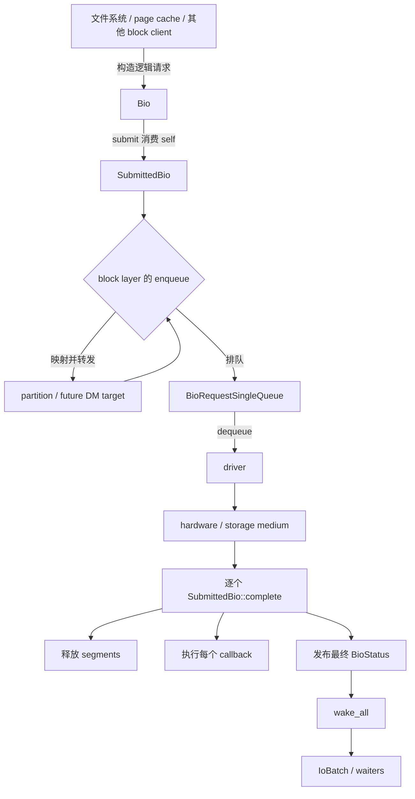
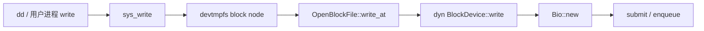

# PR 1：mapped BIO ranges——从三处改动到 block I/O 系统模型

> **学习范围**：上游 PR 1 `block: add mapped BIO ranges`。正式变更范围是基线 `98e71727529efdbe87f35c20bcaceb0fc2e6e8f3` 到提交 `c14d68c93eb9b95835d39a167d0d8ce52a1245f0` 的三个生产文件：
>
> - `kernel/core/comps/block/src/bio.rs`
> - `kernel/core/comps/block/src/partition.rs`
> - `kernel/core/comps/block/src/request_queue.rs`
>
> 本文将 patch 本身视为“冰山之上”：它只修改了少量字段、函数和调用点。要判断这些改动的含义和边界，还必须理解“冰山之下”的请求生命周期、地址坐标系、所有权、DMA 内存、队列合并与上层范围验证。本文严格区分**当前源码事实**、**从模型推导的结论**和**待后续追踪验证的边界**。

## 1. 学习目标与阅读方式

本轮不是把 diff 逐行翻译成 Rust，而是按下列顺序建立可复用的 block I/O 心智模型：

1. 明确一次 I/O 从谁创建、谁提交、谁映射、谁排队、谁完成；
2. 确认每个对象持有什么资源、何时 move、何时共享、何时释放；
3. 区分调用者的 logical address、当前下游设备可见的 mapped address 与 queue 聚合的 request address；
4. 再回到三个文件，理解为何把旧的 `sid_offset` 改成可组合的 `mapped_sid_range`；
5. 最后追踪 VFS、文件系统、page cache、mount 等上层路径，验证 BIO 的构造参数和每层映射输出由谁保证合法。

本文不因为某条主链已经可用，就推断所有相邻路径均具备相同保证。

---

# 第一部分：冰山之上——PR 1 的三个源码文件

## 2. 改动总览

PR 1 的设计转换是：

```text
旧模型
======
immutable logical sid_range
+ 一个可覆盖的 sid_offset
+ request queue 最后自行计算 logical range + offset

新模型
======
immutable logical sid_range
+ 一个可更新、可组合的 mapped_sid_range
+ 每个 block layer 映射后立即把当前下游地址写入 mapped range
+ request queue 直接消费 mapped range
```

用两层线性映射举例：

```text
调用者向当前设备提出：       logical range = [10, 18)
提交后初始化：                mapped range  = [10, 18)
经过 partition，起点为 +100： mapped range  = [110, 118)
经过 future DM linear，+1000：mapped range  = [1110, 1118)
```

原始 logical range 始终保留为 `[10, 18)`；`mapped_sid_range` 只保存**当前累计后的结果**，不保存每层映射历史。

```mermaid
flowchart LR
    A[调用者 logical range<br/>[10, 18)] --> B[BioMetadata::sid_range<br/>immutable]
    B --> C[Bio::submit]
    C --> D[SubmittedBio::mapped_sid_range<br/>初始 [10, 18)]
    D --> E[partition<br/>+100]
    E --> F[mapped [110, 118)]
    F --> G[future linear target<br/>+1000]
    G --> H[mapped [1110, 1118)]
    H --> I[queue / driver<br/>直接使用当前 mapped range]
```

## 3. `bio.rs`：请求数据模型与映射原语

### 3.1 `Bio::new()`：构造 immutable logical range

PR 前，`Bio::new()` 直接对各 segment 的 sector 数求和，并以内建加法构造 range：

```diff
- let nsectors = segments
-     .iter()
-     .map(|segment| segment.nsectors().to_raw())
-     .sum();
-
- sid_range: start_sid..start_sid + nsectors,
+ let nsectors = segments
+     .iter()
+     .map(|segment| segment.nsectors().to_raw())
+     .try_fold(0_u64, u64::checked_add)
+     .expect("BIO sector count overflow");
+ let end = start_sid
+     .to_raw()
+     .checked_add(nsectors)
+     .expect("BIO sector range overflow");
+
+ sid_range: start_sid..Sid::new(end),
```

这里构造的是调用者面对**当前设备**的 logical range：

```text
所有有效 segment 的 sector 数
→ nsectors
→ [start_sid, start_sid + nsectors)
→ BioMetadata::sid_range
```

`try_fold(0_u64, u64::checked_add)` 让总长度无法以 `u64` 表示时停止累加；`checked_add` 让 range 终点无法表示时明确 panic。它们只处理整数表示的回绕风险，**不检查设备容量**。

### 3.2 提交时复制 logical range，建立 mutable mapped range

```diff
         let waiter_metadata = metadata.clone();
+        let mapped_sid_range = metadata.sid_range().clone();
         let submitted_bio = SubmittedBio {
             metadata,
-            sid_offset: 0,
+            mapped_sid_range,
             complete_fn,
             segments,
         };
```

刚提交时：

```text
BioMetadata::sid_range              = logical range
SubmittedBio::mapped_sid_range      = logical range 的副本
```

之后，执行路径仅改变 `mapped_sid_range`；metadata 中的 logical range 不变。因此可同时回答两个不同问题：

```text
调用者最初请求了当前设备的什么位置？
→ BioMetadata::sid_range

此 BIO 经过当前为止的 block layers 后，下一层应处理什么位置？
→ SubmittedBio::mapped_sid_range
```

### 3.3 `SubmittedBio`：从延迟 offset 改为当前映射结果

```diff
 pub struct SubmittedBio {
     metadata: Arc<BioMetadata>,
-    sid_offset: u64,
+    mapped_sid_range: Range<Sid>,
     complete_fn: Option<BioCompleteFn>,
     segments: Vec<BioSegment>,
 }
```

旧 `sid_offset` 的含义是“稍后由 queue 叠加的数值”。它有两个局限：

1. 后一层调用 `set_sid_offset()` 会覆盖前一层值，不能自然表达多层累计；
2. 任何需要当前地址的消费者都必须知道 `logical range + offset` 这一旧表示。

新字段保存的是完整区间，因此当前层处理完成后，下一层只需读取 `sid_range()`，无需了解此前是否经过 partition 或 future target。

### 3.4 `sid_range()`：同名 API 的语义迁移

```diff
-/// Returns the range of target sectors on the device.
+/// Returns the sector range mapped for the current block device layer.
 pub fn sid_range(&self) -> &Range<Sid> {
-    self.metadata.sid_range()
+    &self.mapped_sid_range
 }
```

这里必须分清两个同名入口：

| 对象 | `sid_range()` 的含义 | 可变性 |
|---|---|---|
| `Bio` / `BioMetadata` | 调用者最初向当前设备提出的 logical range | 创建后不可变 |
| `SubmittedBio` | 当前 block layer 已映射、准备交给下游的 range | 可变 |

### 3.5 新增 `remap_sid_start()`：保持长度，指定新起点

```diff
-/// Returns the offset of the first sector ID.
-pub fn sid_offset(&self) -> u64 { ... }
-
-/// Sets the offset of the first sector ID.
-pub fn set_sid_offset(&mut self, offset: u64) { ... }
+/// Remaps the mapped sector range to a new start while preserving its length.
+pub fn remap_sid_start(&mut self, new_start: Sid) -> Result<(), BioEnqueueError> {
+    let length = self
+        .mapped_sid_range
+        .end
+        .to_raw()
+        .checked_sub(self.mapped_sid_range.start.to_raw())
+        .ok_or(BioEnqueueError::Refused)?;
+    let new_end = new_start
+        .to_raw()
+        .checked_add(length)
+        .ok_or(BioEnqueueError::Refused)?;
+    self.mapped_sid_range = new_start..Sid::new(new_end);
+    Ok(())
+}
```

它是这组 API 的基础原语：

```text
[current_start, current_end)
→ 保留 length = current_end - current_start
→ [new_start, new_start + length)
```

前两步都只计算、未修改对象；只有两次可失败计算均成功后，才一次性写回新 range。于是失败不会留下半更新的 `mapped_sid_range`。

它的通用边界是：**输入和输出都必须是一个连续区间，且长度不变。** 它不能表达缩放、扩展、收缩、拆分、跨多个下游设备的映射。

### 3.6 新增 `offset_mapped_sid_range()`：追加本层线性偏移

```diff
+/// Offsets the mapped sector range while preserving its length.
+pub fn offset_mapped_sid_range(&mut self, offset: u64) -> Result<(), BioEnqueueError> {
+    let new_start = self
+        .mapped_sid_range
+        .start
+        .to_raw()
+        .checked_add(offset)
+        .ok_or(BioEnqueueError::Refused)?;
+    self.remap_sid_start(Sid::new(new_start))
+}
```

它是较具体的便利 API：

```text
current start + offset
→ new_start
→ remap_sid_start(new_start)
```

两者不是并列的重复实现：

| API | 调用者提供什么 | 适合表达什么 |
|---|---|---|
| `remap_sid_start(new_start)` | 下游的绝对起点 | target 已依据自身规则算出下游起点 |
| `offset_mapped_sid_range(offset)` | 本层追加的相对偏移 | partition、linear 等固定平移 |

`offset` 是 `remap` 的一个特殊情形：若当前起点为 `110`，追加 `1000`，则 `offset_mapped_sid_range(1000)` 等价于 `remap_sid_start(1110)`。

### 3.7 调试输出也必须迁移字段

结构字段替换后，`Debug` 的字段访问也要同步：

```diff
- .field("sid_offset", &self.sid_offset)
+ .field("mapped_sid_range", &self.mapped_sid_range)
```

这不改变运行时映射语义，却是编译正确性的一部分：删除 `sid_offset` 后继续访问 `self.sid_offset` 会直接报字段不存在。

## 4. `partition.rs`：把本层起点叠加后再转发

`PartitionNode` 是一个 block layer：上游看到的是分区坐标，下游 backing device 看到的是整盘坐标。

```diff
 fn enqueue(&self, mut bio: SubmittedBio) -> Result<(), BioEnqueueError> {
-    bio.set_sid_offset(self.info.start_sector());
+    bio.offset_mapped_sid_range(self.info.start_sector())?;
     self.device.enqueue(bio)
 }
```

示例：

```text
调用者相对 partition 请求：       [10, 18)
partition 起点：                    100
转发给 backing device 的 mapped：  [110, 118)
```

`?` 表示映射失败时立即返回 `BioEnqueueError::Refused`，不会继续把 BIO 转发给下游。成功时，转发的仍是同一个 `SubmittedBio`：其 segment、callback、metadata 和完成责任均未更换，只是 mapped address 已更新。

## 5. `request_queue.rs`：queue 直接消费 mapped range

### 5.1 责任迁移

旧设计下，queue 知道 `sid_offset` 的存在，负责从 logical range 计算设备可见地址。PR 1 后，queue 不再参与地址映射：它只处理已经映射好的 `SubmittedBio::sid_range()`。

```diff
-/// Second, a `BioRequest` provides the physical sector addresses suitable for storage medium.
-/// The sector addresses returned from `SubmittedBio::sid_range()` are logical ones:
-/// they need to be adjusted with `SubmittedBio::sid_offset()` to calculate the physical ones.
-/// This calculation is handled internally by `BioRequest`.
-/// One can simply call `BioRequest::sid_range()` to obtain the physical sector addresses.
+/// Second, a `BioRequest` provides the sector addresses suitable for storage medium.
+/// Block layers may have remapped the submitted BIO. One can simply call
+/// `BioRequest::sid_range()` to obtain the addresses seen by the current device.
```

这里的“当前设备”很重要：地址没有脱离设备对象而独立存在。对 disk A 有意义的 sector `100`，不自动等同于 disk B 的 sector `100`。

### 5.2 合并判断直接比较连续的 mapped range

```diff
-        let sid_offset = rq_bio.sid_offset();
-
-        rq_bio.sid_range().start + sid_offset == self.sid_range.end
-            || rq_bio.sid_range().end + sid_offset == self.sid_range.start
+        rq_bio.sid_range().start == self.sid_range.end
+            || rq_bio.sid_range().end == self.sid_range.start
```

例如 partition 已先完成 `+100` 映射：

```text
BIO A logical [10, 11) → mapped [110, 111)
BIO B logical [11, 12) → mapped [111, 112)
```

queue 只检查：

```text
A.end == B.start
111 == 111
```

### 5.3 合并时维持三个聚合不变量

`BioRequest` 不是一个重新制造的 `SubmittedBio`，而是一个聚合容器：

```rust
pub struct BioRequest {
    type_: BioType,
    sid_range: Range<Sid>,
    num_segments: usize,
    bios: VecDeque<SubmittedBio>,
}
```

合并一个 BIO 时必须同步维持三项状态：

```diff
         let rq_bio_nr_segments = rq_bio.segments().len();
-        let sid_offset = rq_bio.sid_offset();

-        if rq_bio.sid_range().start + sid_offset == self.sid_range.end {
-            self.sid_range.end = rq_bio.sid_range().end + sid_offset;
+        if rq_bio.sid_range().start == self.sid_range.end {
+            self.sid_range.end = rq_bio.sid_range().end;
             self.bios.push_back(rq_bio);
         } else {
-            self.sid_range.start = rq_bio.sid_range().start + sid_offset;
+            self.sid_range.start = rq_bio.sid_range().start;
             self.bios.push_front(rq_bio);
         }

         self.num_segments += rq_bio_nr_segments;
```

| 聚合字段 | 合并后必须代表什么 |
|---|---|
| `sid_range` | 全部 BIO 在当前设备上的连续总覆盖范围 |
| `num_segments` | 全部 BIO 的 DMA segment 数量总和 |
| `bios` | 仍独立存在的全部 `SubmittedBio`，并按 sector 顺序排列 |

例如：

```text
原 request： sid_range [110, 111), num_segments 1, bios [A]
新 BIO B：    sid_range [111, 113), segments [B1, B2]

合并结果：    sid_range [110, 113), num_segments 3, bios [A, B]
```

合并**不是**复制 DMA 数据，不是将两个 callback 合成为一个，也不是创造一个虚构的新 `SubmittedBio`。每个原 BIO 仍持有自己的 metadata、segments 和 `FnOnce` callback，后续必须分别完成。

`VecDeque` 支持双端插入：若新 BIO 接在 request 尾部则 `push_back`，若接在前部则 `push_front`。这样 `bios` 内的排列始终遵从 sector 顺序，而非到达 queue 的偶然时间顺序。

### 5.4 由首个 BIO 创建新的 request

当 queue 内没有可合并 request 时，调用 `From<SubmittedBio> for BioRequest`：

```diff
 impl From<SubmittedBio> for BioRequest {
     fn from(bio: SubmittedBio) -> Self {
-        let mut sid_range = bio.sid_range().clone();
-        sid_range.start = sid_range.start + bio.sid_offset();
-        sid_range.end = sid_range.end + bio.sid_offset();
+        let sid_range = bio.sid_range().clone();

         Self {
             type_: bio.type_(),
             sid_range,
             num_segments: bio.segments().len(),
             bios: {
                 let mut bios = VecDeque::with_capacity(1);
                 bios.push_front(bio);
                 bios
             },
         }
     }
 }
```

`From<SubmittedBio> for BioRequest` 是 Rust 标准转换 trait 的实现，表示：一个 `SubmittedBio` 可无失败地转换为一个仅含自身的初始 `BioRequest`。

```text
SubmittedBio
→ move 进 BioRequest::bios
→ BioRequest 再 move 进 queue
→ driver dequeue 后取得该 request
```

这里是 move 而非复制。转换后，原变量不再可用；queue request 接管了 BIO 的所有权。

---

# 第二部分：冰山之下——理解改动所依赖的系统模型

## 6. I/O 生命周期、所有权与完成路径



### 6.1 `Bio` 与 `SubmittedBio`

| 对象 | 所在阶段 | 独占资源 | 能否再次提交 |
|---|---|---|---|
| `Bio` | 尚未提交的逻辑请求 | `segments`、`complete_fn` | 可以首次提交 |
| `SubmittedBio` | 已移交给 block stack 的执行请求 | 同一批 `segments`、同一个 `FnOnce` callback | 不可再次提交 |

`Bio::submit(self, ...)` 消费 `Bio`。因此提交成功后，不存在“调用者继续持有并修改同一 BIO”的模型。

### 6.2 `BioMetadata`：共享身份与完成状态

```rust
struct BioMetadata {
    type_: BioType,
    sid_range: Range<Sid>,
    status: AtomicU32,
    wait_queue: WaitQueue,
}
```

提交后其典型所有权图是：

```text
SubmittedBio ── Arc<BioMetadata> ── 执行 / 完成路径
IoBatch      ── Arc<BioMetadata> ── 提交者 / 等待路径
```

`Arc` 只保证共享生命周期和最后释放时机，**不保证内部数据可被并发安全修改**。本对象的并发事实来自：

| 成员 | 并发模型 |
|---|---|
| `type_`、logical `sid_range` | 创建后只读 |
| `status` | `AtomicU32` 的原子状态发布与观察 |
| `wait_queue` | 等待者睡眠、完成方唤醒 |

### 6.3 状态与等待

```text
Init
  │ submit 的 CAS 成功
  ▼
Submit
  │ complete
  ▼
Complete / NotSupported / NoSpace / IoError
```

`Submit` 表示请求已脱离调用者、进入异步 block I/O 生命周期；它不等于已经抵达最终硬件、已经进入某个固定 request queue，或已经拥有全局物理地址。

若 `enqueue` 失败，提交路径将状态从 `Submit` 回退为 `Init`，并返回 `BioEnqueueError`。

`wait_queue` 不保存 BIO，也不保存最终结果：

```text
等待方：看到 status == Submit → 睡眠
完成方：写入最终 status → wake_all()
等待方：醒来后重新读取 status
```

最终事实来源始终是 `status`；wake-up 的含义只是“状态可能变化”。

### 6.4 `IoBatch` 不是 request queue

| 对象 | 持有内容 | 职责 |
|---|---|---|
| `IoBatch` | `Arc<dyn IoCompletion>`，BIO 场景中是 metadata | 提交者批量等待完成 |
| `BioRequestSingleQueue` | `BioRequest`，其中包含多个 `SubmittedBio` | 向 driver 排队、合并、FIFO 消费 |

`IoBatch::wait_all()` 即使较早的操作失败，也会继续等待其余 record，最后返回第一个观察到的错误。它不参与 driver 侧调度或完成。

## 7. DMA segment、数据长度与资源生命周期

`BioSegment` 是带方向信息的 DMA 可访问**有效内存 slice**，不是“一个 page”的同义词。

| 粒度 | 当前实现 | 主要用途 |
|---|---|---|
| block | `BLOCK_SIZE = PAGE_SIZE` | DMA backing memory 的分配、pool 管理 |
| sector | `SECTOR_SIZE = 512 B` | block device 的寻址、BIO 传输长度 |
| segment | 一段有效 DMA slice | 一个 BIO 中的 scatter-gather 数据段 |

例如 10 sectors 为 5 KiB：它至少需要两个 4 KiB block 的 backing capacity，但可表现为一个有效长度为 5 KiB 的 `BioSegment`，不要求一 page 对应一个 segment。

```text
BioSegment backing memory
├─ 优先：按方向从 DMA arena pool 分配 block
└─ pool 未初始化或空间不足：直接 DMA 分配

有效 offset / len 必须以 sector 对齐
Bio → SubmittedBio → complete / 丢弃
                         └─ backing memory 才可释放或复用
```

`BioRequest` 合并时保留每个 BIO 的 `segments`，正是为了不复制或重组 DMA 数据，同时保持原请求的独立完成边界。

## 8. 多层地址映射：为什么不是“最后再加总 offset”

在纯线性场景中，累计 offset 在数学上可行：

```text
logical [10, 18)
+ partition 100
+ linear 1000
= [1110, 1118)
```

但 block layer 并不保证只有最终 queue 才需要地址。任一 `enqueue()` 接收者都可能：

```text
继续映射并转发
或立即入自己的 request queue
或进行本层范围检查
或同步完成
或拒绝
```

若仅保存 `logical range + total_offset`，每个地址消费者都要记得并正确解释这一表示。PR 1 改为：

```text
每个映射层
→ 将自己的地址变换立刻落实为 mapped_sid_range
→ 下游只读取当前可用地址
```

更深的原因是不存在天然的“全局最终地址”：不同 backing device 各自拥有坐标系。只有“当前这一层准备交给哪一个下游设备、该设备应从哪个 sector 开始”具有明确语义。

## 9. partition、linear 与 striped 的能力边界

| 层 / target 类型 | 一个输入 BIO 是否可保持为一个输出 BIO | 是否可只用本 PR 的 range API |
|---|---:|---:|
| partition | 是，固定正向平移 | 是，`offset_mapped_sid_range` |
| linear target | 通常是，映射为一个连续下游区间 | 是，偏移或指定 `new_start` |
| striped target，不跨边界 | 可能是 | 对单段可用 `remap_sid_start` |
| striped target，跨 stripe 边界 | 否 | 否，必须额外 split / fan-out / 聚合 |

例如两个 device、每 stripe 8 sectors：

```text
逻辑 [0, 8)    → disk A [0, 8)
逻辑 [8, 16)   → disk B [0, 8)

输入 BIO [6, 14)
→ 子 BIO A [6, 8)  → disk A [6, 8)
→ 子 BIO B [8, 14) → disk B [0, 6)
```

完整输入已经不再对应一个输出 range 或一个下游 device。target 层需要：

```text
识别 stripe 边界
→ 切分数据和请求
→ 为每段选择 backing device
→ 分别提交
→ 聚合多个异步完成结果
→ 仅在全部完成后完成原请求
```

因此 `remap_sid_start()` 的“通用性”仅限于**单段、连续、等长**的地址变换；它是 block-layer 基础原语，不是任意 DM target 的完整实现。

## 10. 上层 I/O 来源与范围验证边界

已追踪的标准 raw block-device 用户写主链如下：



当前已确认的源码事实：

| 层 | 已确认行为 |
|---|---|
| `OpenBlockFile::write_at` | 根据 `nr_sectors × 512` 判断用户 offset/length；从尾端或之后开始写返回 `ENOSPC`，跨越尾端的写截断为短写 |
| `dyn BlockDevice::write` | 用完整范围检查拒绝无法完整消费 reader 的越界请求；通过后才构造 `Bio::new` |
| `Bio::new` | 不持有 `BlockDevice` 或 `nr_sectors`，只构造数值上的 logical range，不负责设备容量验证 |

因此：标准 `dd of=/dev/<block-device>` 写入路径不依赖 `Bio::new` 来阻止超设备尾端的请求。

但不能由此推出“所有 BIO 构造者均已验证”。后续仍应逐条追踪：

| 待学习入口 | 要确认的问题 |
|---|---|
| 用户 read/write 与 VFS 文件对象 | 谁验证 offset、length 与可访问范围？ |
| filesystem / page cache 读写与回写 | 谁将 file offset 转为 block request？谁处理文件扩展、洞和 `ENOSPC`？ |
| devtmpfs block node | 节点如何关联 `BlockDevice`，open 后得到什么对象？ |
| mount | mount 何时通过文件系统元数据读取间接触发 block I/O？ |
| 内部 block API | 每个 `Bio::new` 调用点是否有本层或上层范围不变量？ |
| partition / future DM target | 输入是否不超逻辑设备边界，输出是否不超 backing device 边界？ |

`checked_add` 防止 `u64` 二进制回绕；容量检查则必须基于目标设备的 `nr_sectors` 或已经建立的上层边界，两者不可混同。

---

# 第三部分：不变量、结论与后续学习

## 11. PR 1 依赖的不变量

| 不变量 | 责任位置 | 破坏后的后果 |
|---|---|---|
| logical range 创建后不变 | `BioMetadata` | 无法回溯调用者原始请求语义 |
| mapped range 始终表示当前下游设备地址 | 每个 block layer | queue / driver 使用错误坐标系 |
| `remap_sid_start` 保持长度 | `SubmittedBio` 映射 API | 数据长度与请求地址范围脱节 |
| 映射失败不部分写回 range | 映射 API | BIO 处于无法解释的半更新状态 |
| `BioRequest::sid_range` 覆盖全部 member BIO | request queue | driver 请求范围和实际数据段不一致 |
| `num_segments` 是 member BIO segment 数之和 | request queue | 突破或错误判断硬件 scatter-gather 上限 |
| 每个 member BIO 仍独立完成 | driver / completion path | callback、metadata 或等待者被遗漏 |
| 每层映射输出落在下游合法范围 | 上游验证与 block layer 合约 | 可能访问错误设备区域 |

## 12. 当前结论的证据等级

| 结论 | 证据等级 | 说明 |
|---|---|---|
| PR 1 将 `sid_offset` 替换为 `mapped_sid_range` | 当前 PR 源码事实 | 三个正式文件的 diff |
| request queue 不再进行 offset 计算 | 当前 PR 源码事实 | 合并判断、合并更新、`From` 初始化均直接使用 `sid_range()` |
| `mapped_sid_range` 支持多层连续、等长映射 | 源码事实加模型推导 | 映射 API 的输入/输出语义 |
| standard raw `dd` 写主链在 `Bio::new` 前有范围处理 | 当前基线源码事实 | raw block file 与 `dyn BlockDevice::write` 审计 |
| 所有 BIO 来源都已经完成容量验证 | 未证实 | 必须继续逐路径追踪 |
| striped target 需要 split、fan-out、completion 聚合 | 映射模型推导 | 跨 stripe 输入不再是一对一连续映射；不代表当前 PR 已实现 striped |

## 13. 后续学习入口

生产代码的核心改动已经形成一个闭环：

```text
bio.rs
  构造 immutable logical range
  → submit 时初始化 mapped range
  → 提供 remap / offset 映射原语

partition.rs
  → 追加 partition 起点后转发

request_queue.rs
  → 直接消费 mapped range
  → 维护 request range、segment 总数、原始 BIO 队列
```

下一阶段再进入 ktest，验证两个行为：

1. `SubmittedBio` 的 remap / offset API 保持长度、正确更新地址并拒绝表示溢出；
2. 两个原始 logical 地址不连续、但 remap 后连续的 BIO，能在 queue 中合并为一个 `BioRequest`，且保持正确的 range、BIO 数量与 segment 总数。

之后再继续冰山下的上层路径学习：用户 I/O、VFS、filesystem、page cache、devtmpfs 和 mount 的 BIO 构造与范围验证责任链。

## 14. 参考范围

- PR 1 技术档案：[PR-1-mapped-bio-ranges.md](../PR/PR-1-mapped-bio-ranges.md)
- PR 1 基线：`98e71727529efdbe87f35c20bcaceb0fc2e6e8f3`
- PR 1 最终提交：`c14d68c93eb9b95835d39a167d0d8ce52a1245f0`
- 学习练习副本（不在本仓库内）：`/root/github/asterinas-pr1-practice`
